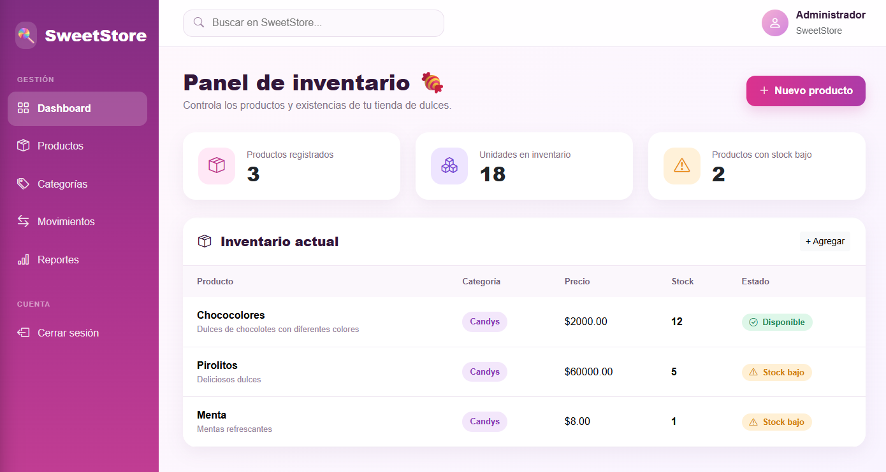
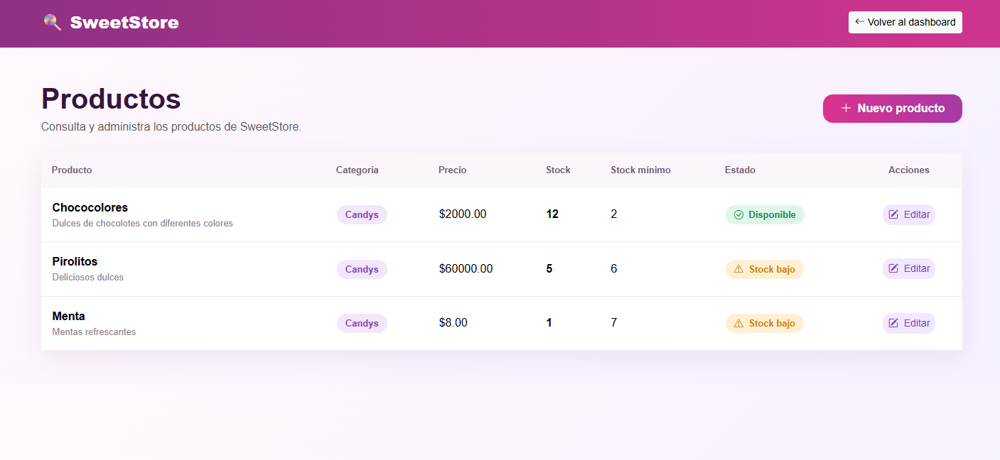
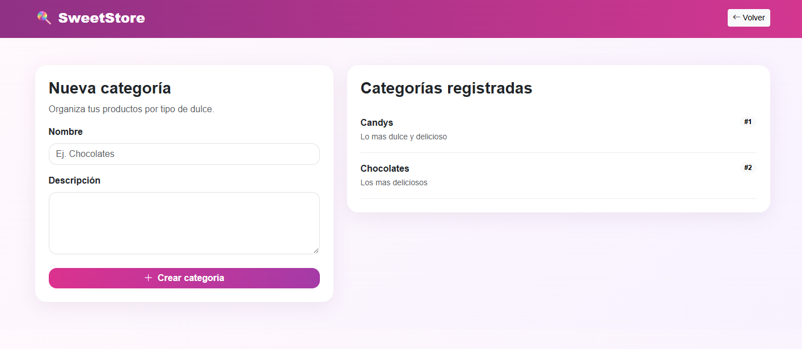
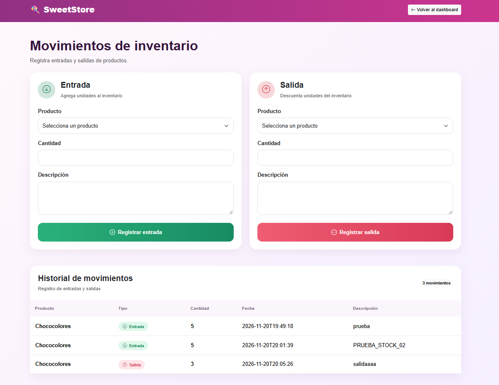
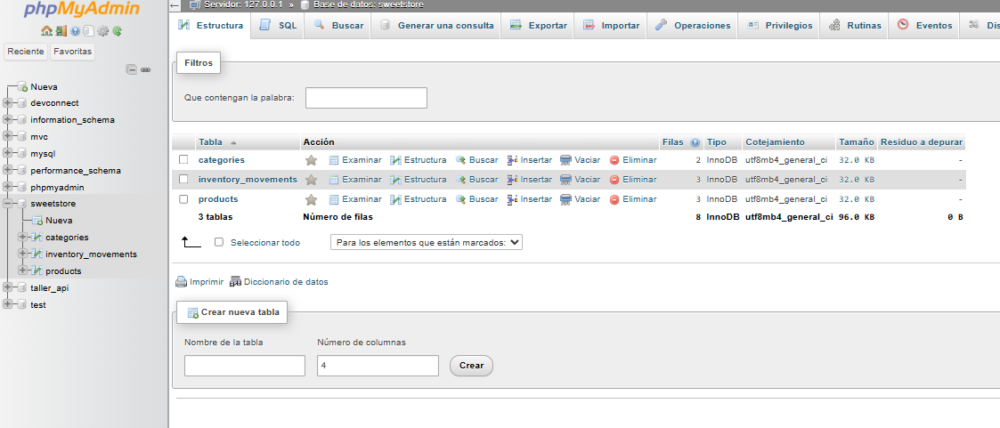
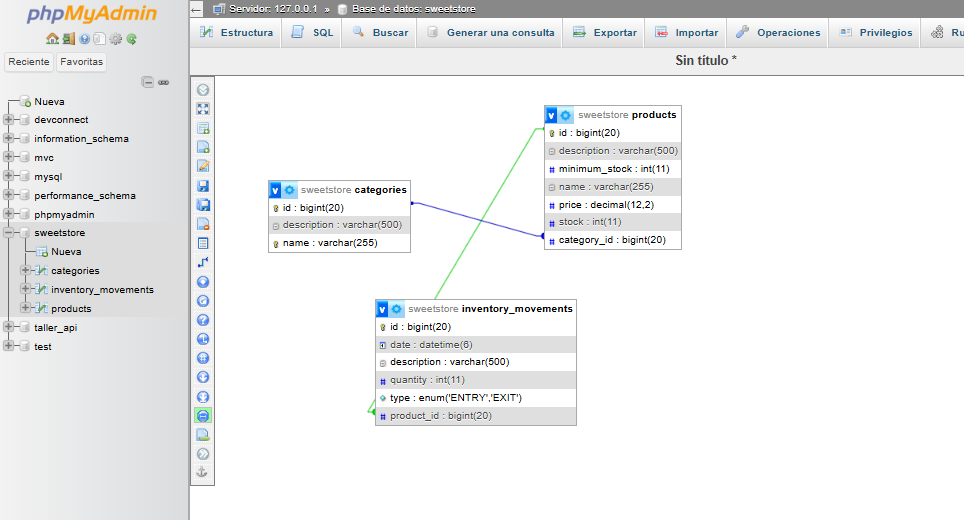
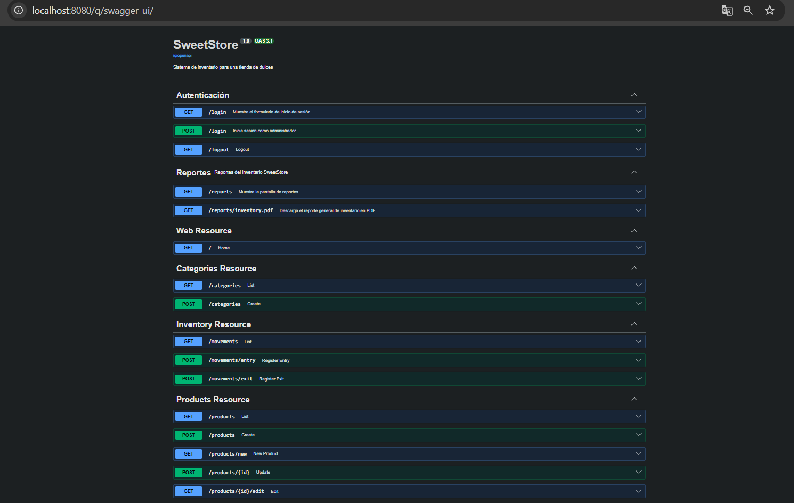
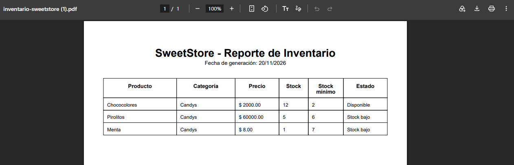

SweetStore

**Sistema de inventario para una tienda de dulces**

Proyecto integrador de la asignatura **Desarrollo Orientado a Servicios – 2026-2**, del programa de Ingeniería de Sistemas de la Universidad Santo Tomás, Seccional Tunja.

SweetStore permite administrar el catálogo de productos y categorías de una tienda de dulces, controlar las existencias mediante movimientos de entrada y salida, identificar productos con stock bajo y consultar o descargar un reporte general del inventario en PDF.

> Este README describe la configuración incluida en el proyecto. Si el entorno local utiliza otro usuario, contraseña o puerto de MySQL, ajuste los valores indicados antes de ejecutar la aplicación.

------------------------------------------------------------------------

## 1. Funcionalidades

- Inicio y cierre de sesión de administrador.
- Registro y consulta de categorías.
- Registro, consulta y edición de productos.
- Asociación de cada producto con una categoría.
- Registro de movimientos de entrada de inventario.
- Registro de movimientos de salida de inventario.
- Actualización de las existencias a partir de los movimientos.
- Validación de reglas de inventario, como cantidades válidas y disponibilidad para las salidas.
- Identificación de productos que alcanzan o están por debajo del stock mínimo.
- Consulta de reportes y descarga del inventario en formato PDF.
- Documentación de los recursos mediante Swagger UI y OpenAPI.

### Evidencias del funcionamiento del sistema

#### 1. Panel principal (Dashboard)

El dashboard presenta un resumen general del inventario, incluyendo la cantidad de productos registrados, unidades disponibles y productos con stock bajo.

**Evidencia:**



#### 2. Gestión de productos

El sistema permite registrar, consultar, editar y administrar los productos de la tienda, incluyendo su nombre, descripción, precio, stock y categoría.

**Evidencia:**



#### 3. Gestión de categorías

Permite administrar las categorías utilizadas para clasificar los productos del inventario.

**Evidencia:**



#### 4. Movimientos de inventario

El sistema registra las entradas y salidas de productos, almacenando la fecha, descripción, cantidad y tipo de movimiento.

**Evidencia:**



#### 5. Base de datos MySQL

La base de datos `sweetstore` contiene las tablas `categories`, `products` e `inventory_movements`, utilizadas para almacenar la información del sistema.

**Evidencia:**



#### 6. Relaciones de la base de datos

Se implementaron restricciones de integridad referencial para relacionar los productos con sus categorías y los movimientos con los productos correspondientes.

**Evidencia:**



#### 7. Documentación de la API

SweetStore dispone de documentación OpenAPI y una interfaz Swagger UI para consultar los endpoints disponibles.

**Evidencia:**



#### 8. Reportes de inventario

El sistema permite generar y descargar reportes de inventario en formato PDF con información de los productos registrados.

**Evidencia:**



## 2. Tecnologías utilizadas

| Tecnología                    | Uso                                            |
|-------------------------------|------------------------------------------------|
| Java 21                       | Lenguaje de programación                       |
| Quarkus 3.40.1.1              | Framework de la aplicación                     |
| Maven y Maven Wrapper         | Gestión de dependencias y ejecución            |
| MySQL                         | Base de datos relacional                       |
| XAMPP                         | Entorno local para ejecutar MySQL y phpMyAdmin |
| Hibernate ORM / JPA           | Persistencia y mapeo objeto-relacional         |
| Qute                          | Motor de plantillas para las vistas HTML       |
| Bootstrap 5                   | Estilos y componentes de interfaz              |
| OpenPDF 1.3.43                | Generación de reportes PDF                     |
| SmallRye OpenAPI / Swagger UI | Documentación de los recursos web              |

## 3. Arquitectura del proyecto

La aplicación está organizada siguiendo el enfoque de **arquitectura hexagonal (puertos y adaptadores)**. La intención es mantener las reglas del negocio en el dominio y evitar que este dependa de Quarkus, de las vistas o de la tecnología de persistencia.

La estructura principal del código fuente es:

``` text
src/main/java/usta/sweetstore/
├── domain/
│   ├── exception/
│   ├── model/
│   └── service/
├── application/
│   ├── port/
│   │   ├── in/
│   │   └── out/
│   └── usecase/
└── infrastructure/
    └── adapter/
        ├── in/
        │   └── web/
        └── out/
            └── persistence/
                ├── adapter/
                ├── entity/
                ├── mapper/
                └── repository/
```

### Dominio (`domain`)

Contiene los modelos y las reglas de negocio, sin depender de las tecnologías externas.

- `Product`: representa un producto, su precio, existencias, stock mínimo y categoría.
- `Category`: representa una categoría de productos.
- `InventoryMovement`: representa un movimiento de inventario.
- `MovementType`: identifica el tipo de movimiento.
- `InventoryService`: contiene reglas para validar productos y gestionar entradas y salidas de existencias.
- `BusinessRuleException`: representa errores de reglas de negocio.

### Aplicación (`application`)

Contiene los puertos y los casos de uso que coordinan las operaciones del sistema.

- `port/in`: interfaces de los casos de uso para gestionar productos, categorías e inventario.
- `port/out`: interfaces que definen las operaciones de persistencia requeridas por la aplicación.
- `usecase`: implementaciones de los casos de uso.

### Infraestructura (`infrastructure`)

Contiene los adaptadores que conectan la aplicación con el exterior.

- `adapter/in/web`: recursos web, autenticación, vistas Qute y generación del reporte PDF.
- `adapter/out/persistence/entity`: entidades JPA que representan las tablas de MySQL.
- `adapter/out/persistence/mapper`: conversión entre modelos del dominio y entidades de persistencia.
- `adapter/out/persistence/repository`: repositorios JPA.
- `adapter/out/persistence/adapter`: implementaciones de los puertos de salida.

En términos generales, el navegador interactúa con el adaptador web; este utiliza los casos de uso de la aplicación, y los casos de uso acceden a la persistencia mediante los puertos definidos.

## 4. Modelo de datos

La persistencia utiliza tres entidades principales relacionadas:

| Entidad / tabla       | Descripción                                                  | Relación                                                       |
|-----------------------|--------------------------------------------------------------|----------------------------------------------------------------|
| `categories`          | Almacena las categorías de productos.                        | Una categoría puede estar asociada a varios productos.         |
| `products`            | Almacena nombre, descripción, precio, stock y stock mínimo.  | Cada producto pertenece a una categoría mediante`category_id`. |
| `inventory_movements` | Almacena tipo, cantidad, fecha y descripción del movimiento. | Cada movimiento pertenece a un producto mediante`product_id`.  |

Las relaciones entre productos y categorías, y entre movimientos y productos, se representan mediante relaciones JPA `@ManyToOne` y sus respectivas llaves foráneas.

La aplicación está configurada para actualizar el esquema de Hibernate con la estrategia `update`. La base de datos se configura en la URL JDBC con `createDatabaseIfNotExist=true`.

## 5. Requisitos previos

Antes de ejecutar el proyecto, asegúrese de tener instalado:

1.  **Java JDK 21** o una versión compatible con la configuración del proyecto.
2.  **XAMPP**, con el servicio MySQL iniciado.
3.  **IntelliJ IDEA** u otro IDE compatible con Maven (opcional, pero recomendado).
4.  Git, si se va a clonar el repositorio.

Compruebe que MySQL esté escuchando en el puerto `3306`. Apache puede iniciarse desde XAMPP para acceder a phpMyAdmin, pero la aplicación necesita principalmente que MySQL esté activo.

## 6. Configuración de la base de datos

La configuración incluida en `src/main/resources/application.properties` es:

``` properties
quarkus.datasource.db-kind=mysql
quarkus.datasource.username=root
quarkus.datasource.password=
quarkus.datasource.jdbc.url=jdbc:mysql://localhost:3306/sweetstore?createDatabaseIfNotExist=true

quarkus.hibernate-orm.schema-management.strategy=update
```

Por defecto, esta configuración utiliza:

- Servidor: `localhost`
- Puerto: `3306`
- Base de datos: `sweetstore`
- Usuario: `root`
- Contraseña: vacía

Estos valores corresponden a la configuración del proyecto y pueden variar según la instalación local de XAMPP. Si su MySQL utiliza otra contraseña o puerto, actualice `application.properties`.

Con `createDatabaseIfNotExist=true`, el controlador puede crear la base de datos si el usuario configurado tiene permisos suficientes. Hibernate administra la actualización del esquema con la estrategia `update`.

Para comprobar la base de datos, abra phpMyAdmin:

- http://localhost/phpmyadmin

Busque la base de datos `sweetstore` y compruebe las tablas `categories`, `products` e `inventory_movements` después de iniciar la aplicación.

## 7. Ejecución del proyecto en Windows

### 7.1. Iniciar MySQL

1.  Abra XAMPP Control Panel.
2.  Inicie **MySQL**.
3.  Compruebe que el servicio aparezca activo.
4.  Si desea utilizar phpMyAdmin desde el navegador, inicie también Apache.

### 7.2. Abrir el proyecto

Abra la carpeta raíz del proyecto en IntelliJ IDEA. La carpeta raíz es aquella donde se encuentran `pom.xml`, `mvnw` y `mvnw.cmd`.

### 7.3. Compilar

Abra la terminal en la carpeta raíz y ejecute:

``` powershell
.\mvnw.cmd clean compile
```

Si la compilación termina correctamente, Maven mostrará `BUILD SUCCESS`.

### 7.4. Ejecutar en modo desarrollo

En la misma terminal ejecute:

``` powershell
.\mvnw.cmd quarkus:dev
```

Cuando Quarkus haya iniciado, abra la aplicación en:

- http://localhost:8080

Para detener la aplicación, regrese a la terminal y presione `Ctrl + C`.

### Comandos equivalentes en Linux o macOS

Desde la carpeta raíz del proyecto:

``` bash
./mvnw clean compile
./mvnw quarkus:dev
```

Si el sistema no permite ejecutar el wrapper, puede otorgarle permiso de ejecución con `chmod +x mvnw`.

## 8. Accesos de la aplicación

Con la aplicación ejecutándose en el puerto `8080`, las direcciones principales son:

| Recurso                   | Dirección                                   |
|---------------------------|---------------------------------------------|
| Aplicación                | http://localhost:8080                       |
| Inicio de sesión          | http://localhost:8080/login                 |
| Productos                 | http://localhost:8080/products              |
| Categorías                | http://localhost:8080/categories            |
| Movimientos de inventario | http://localhost:8080/movements             |
| Reportes                  | http://localhost:8080/reports               |
| Descargar reporte PDF     | http://localhost:8080/reports/inventory.pdf |
| Swagger UI                | http://localhost:8080/q/swagger-ui          |
| Documento OpenAPI         | http://localhost:8080/q/openapi             |

Algunas pantallas y operaciones requieren iniciar sesión como administrador.

### Credenciales iniciales de administrador

La configuración del proyecto define las siguientes credenciales iniciales:

- Usuario: `admin`
- Contraseña: `admin123`

Son credenciales de demostración para el entorno local. No deben conservarse en un despliegue público o productivo; cambie la contraseña y gestione los secretos mediante una configuración segura.

## 9. Reporte PDF

El sistema dispone de un reporte general de inventario generado con OpenPDF. El reporte se puede solicitar desde la sección **Reportes** de la aplicación o desde la ruta:

``` text
GET /reports/inventory.pdf
```

La respuesta se entrega con el tipo de contenido `application/pdf` y permite descargar el documento con información del inventario almacenada en la base de datos.

## 10. Documentación OpenAPI y Swagger

La documentación de los recursos web se genera mediante SmallRye OpenAPI y se visualiza con Swagger UI.

- Interfaz interactiva: http://localhost:8080/q/swagger-ui
- Especificación OpenAPI: http://localhost:8080/q/openapi

La documentación incluye los recursos de autenticación, página principal, categorías, productos, movimientos de inventario y reportes.

## 11. Solución de problemas frecuentes

### MySQL no inicia en XAMPP

- Compruebe si otro servicio está utilizando el puerto `3306`.
- Revise el mensaje de error del panel de XAMPP.
- Verifique que el servicio MySQL esté activo antes de iniciar Quarkus.

### Error de conexión con MySQL

- Compruebe que MySQL esté iniciado.
- Verifique el puerto, usuario y contraseña en `application.properties`.
- Confirme que el usuario tenga permisos para crear o utilizar la base de datos `sweetstore`.

### La aplicación no abre en el navegador

- Compruebe que Quarkus haya iniciado correctamente.
- Revise si el puerto `8080` está ocupado.
- Consulte los mensajes de error de la terminal donde ejecutó `quarkus:dev`.

### Error de compilación

Ejecute nuevamente:

``` powershell
.\mvnw.cmd clean compile
```

Revise el primer error reportado por Maven y compruebe que se esté utilizando JDK 21.

### No se descarga el PDF

- Inicie sesión si la operación lo requiere.
- Compruebe que existan datos de inventario.
- Revise los mensajes de la terminal de Quarkus.

## 12. Alcance y consideraciones

SweetStore es un proyecto académico orientado a demostrar la aplicación de arquitectura hexagonal, reglas de negocio, persistencia relacional, vistas web y generación de reportes.

La aplicación se ejecuta localmente y utiliza MySQL. La configuración de desarrollo no debe considerarse una configuración de producción. Antes de desplegarla en un entorno real se deben fortalecer las credenciales, revisar la seguridad de las sesiones y configurar adecuadamente los secretos y permisos de la base de datos.


## 13. Información académica

**Universidad:** Universidad Santo Tomás – Seccional Tunja

**Programa:** Ingeniería de Sistemas

**Asignatura:** Desarrollo Orientado a Servicios

**Periodo:** 2026-2

**Proyecto:** SweetStore – Sistema de inventario para una tienda de dulces

**Repositorio GitHub:** [sweetstore-hexagonal](https://github.com/juanDieg016/sweetstore-hexagonal)

### Integrantes del proyecto

| N.º | Nombre completo              | Rol en el proyecto                     |
|:---:|------------------------------|----------------------------------------|
|  1  | Juan Diego Verdugo Aparicio  | Líder y coordinador del proyecto       |
|  2  | Brayan Alexander Naranjo Leiva | Desarrollo backend y lógica de negocio |
|  3  | Daniela Sofía Coy Porras| Base de datos y persistencia           |
|  4  | Paula Andrea Niño Pedraza| Interfaz web y documentación           |


**SweetStore – Gestión organizada del inventario de una tienda de dulces.**
